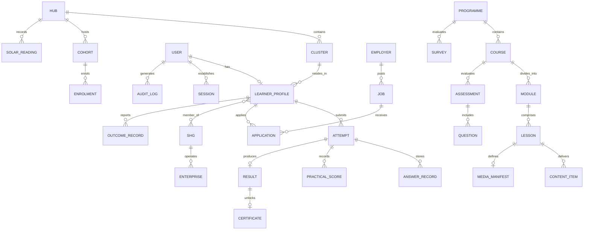

# Urja Kaushal Data Model & Entity Relationship Specification

## 1. Domain Entities
The Urja Kaushal LMS domain model represents the complete lifecycle of rural clean energy training, certification, and livelihood placement across Jamnagar's 10 village clusters.

## 2. Core Schemas & Attributes

### `User` & `LearnerProfile`
- `id`: string (UUID)
- `name`: string
- `phone`: string (masked by default, e.g., `+91 98*** **421`)
- `email`: optional string
- `role`: `'learner' | 'trainer' | 'coordinator' | 'assessor' | 'employer' | 'pm' | 'funder' | 'admin'`
- `language`: `'gu' | 'hi' | 'en'`
- `hubId`: string (reference to one of 10 clusters)
- `gender`: `'female' | 'male' | 'other' | 'prefer_not_to_say'`
- `education`: `'10th_pass' | '12th_pass' | 'iti' | 'diploma' | 'graduate' | 'other'`
- `shgMember`: boolean
- `shgName`: optional string
- `stipendEligible`: boolean
- `preferredTiming`: `'morning' | 'afternoon' | 'evening' | 'women_only'`
- `consentJobSharing`: boolean
- `consentEvaluation`: boolean
- `pin`: string (4-digit security PIN for shared devices)

### `Hub` & `Cluster`
- `id`: string (`hub_moti_khavdi`, `hub_rangpar`, etc.)
- `name`: string (e.g., "Moti Khavdi Solar Hub")
- `cluster`: string
- `lat`: number, `lng`: number
- `solarCapacityKW`: number (default: 25 kW)
- `annualTargetMWh`: number (default: 37.5 MWh)
- `status`: `'commissioned' | 'under_construction' | 'planned'`
- `currentCohort`: string

### `Course`, `Module`, `Lesson`
- `id`: string
- `stream`: `'A' | 'B' | 'C' | 'D'`
- `title`: { gu: string, hi: string, en: string }
- `description`: { gu: string, hi: string, en: string }
- `durationHours`: number (Solar Flagship = 600 hours)
- `nsqfLevel`: number (e.g., Level 4 Suryamitra)
- `modes`: `('audio' | 'video' | 'av')[]`

### `Assessment`, `Question`, `Certificate`
- `id`: string
- `type`: `'micro_check' | 'module_quiz' | 'practice_exam' | 'final_theory' | 'practical'`
- `passPercentage`: number (default 60%)
- `certificateEligible`: boolean
- `certId`: unique public verifiable hash (e.g., `UK-2026-MK-0842`)

